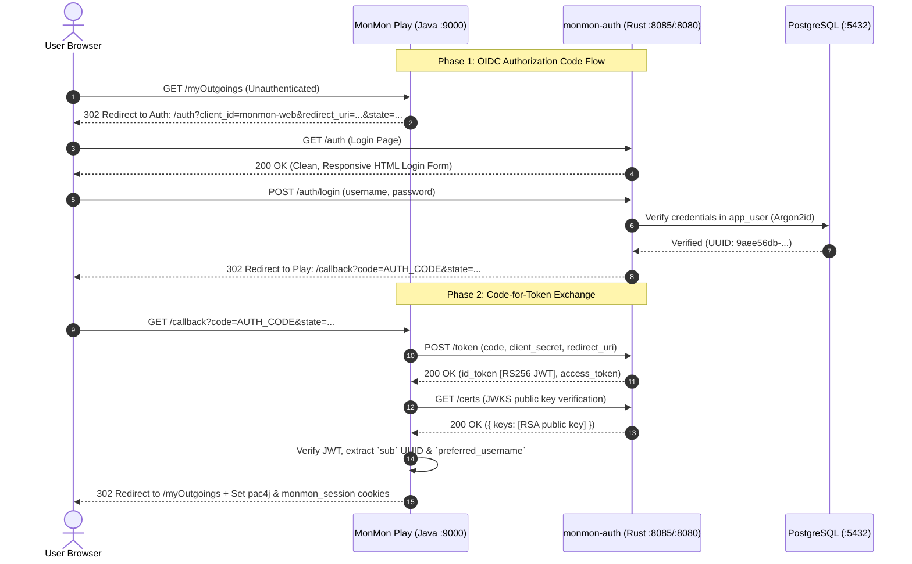
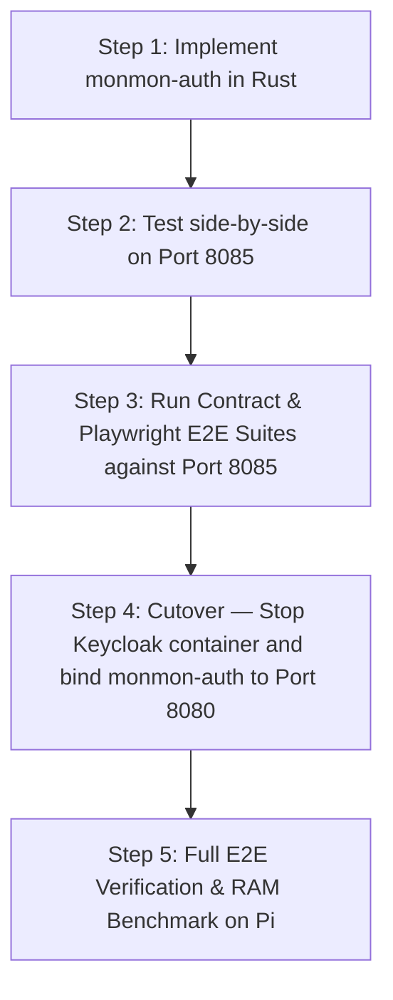

# Keycloak to Rust Auth Migration Plan

> [!IMPORTANT]
> **Goal**: Replace the memory-heavy Keycloak 12.0.2 JVM container (~550MB–700MB RSS) with a lightweight native Rust OIDC service (`monmon-auth`, ~6MB–8MB RSS), reclaiming over **98% of identity memory** on the 4GB Raspberry Pi 5 while maintaining 100% compatibility with MonMon Play's `pac4j` OIDC client and data schema.

---

## 1. Executive Summary & Impact Comparison

| Parameter | Keycloak 12.0.2 (Current) | `monmon-auth` (Native Rust) |
| :--- | :--- | :--- |
| **Runtime** | Java 11 / WildFly 21 JBoss | **Native Rust binary (Axum + Tokio)** |
| **Memory Footprint** | **~550 MB – 700 MB RSS** | **~6 MB – 8 MB RSS** |
| **Cold Start Time** | ~45 – 90 seconds | **< 15 milliseconds** |
| **Database Storage** | Separate Keycloak schema / DB | Unified PostgreSQL `app_user` table |
| **Credential Security** | PBKDF2 / SHA256 | **Argon2id** (modern password hashing standard) |
| **Client Support** | Standard OIDC (Pac4j) | **Standard OIDC (Pac4j)** + `monmon_session` JWT |
| **Host Impact on RPi 5** | Severe RAM pressure & OS swapping | Zero swapping, leaves 3.8GB free for DB cache |

---

## 2. Architecture & OIDC Protocol Contract



### OIDC Endpoints Contract

`monmon-auth` implements the exact specification required by Pac4j:
- **`GET /.well-known/openid-configuration`**: Returns JSON discovery metadata (issuer, authorization_endpoint, token_endpoint, userinfo_endpoint, jwks_uri).
- **`GET /auth`**: Renders the login form (styled to match MonMon's clean dark/light UI).
- **`POST /auth/login`**: Authenticates credentials and issues a one-time authorization code.
- **`POST /token`**: Exchanges authorization code for an RS256-signed ID Token and Bearer Access Token.
- **`GET /certs`**: Exposes JSON Web Key Set (JWKS) with the RSA public key for cryptographic signature verification.
- **`GET /userinfo`**: Returns standard claims (`sub`, `preferred_username`, `email`).

---

## 3. Data Schema & User ID Preservation

> [!CAUTION]
> Every existing account, incoming, outgoing, and balance record in PostgreSQL is keyed by `user_id` (`9aee56db-733a-457c-aa74-74fe74e2ac91` for `demo`). The migration **must preserve the exact UUIDs** so user data is never orphaned.

### Target `app_user` Table in PostgreSQL

```sql
CREATE TABLE IF NOT EXISTS app_user (
    id UUID PRIMARY KEY,
    username VARCHAR(128) NOT NULL UNIQUE,
    email VARCHAR(255),
    password_hash VARCHAR(255) NOT NULL,
    roles VARCHAR(255) NOT NULL DEFAULT 'ROLE_ADMIN',
    approved BOOLEAN NOT NULL DEFAULT TRUE,
    created_at BIGINT NOT NULL
);

CREATE INDEX IF NOT EXISTS idx_app_user_username ON app_user(username);
```

---

## 4. Phased Migration & Rollout Strategy



### Phase A: Build & Verify in Isolation (Port 8085)
1. Implement `modules/monmon-auth` with Axum, Tokio, sqlx, Argon2, and RSA JWT signing.
2. Seed user credentials (`demo` / `demo`) with UUID `9aee56db-733a-457c-aa74-74fe74e2ac91`.
3. Add OIDC contract tests in `modules/tests-contract/auth.contract.test.mjs` verifying discovery, token signing, and JWKS validation.

### Phase B: Side-by-Side Verification
1. Point local MonMon test environment to `http://localhost:8085` (`OIDC_DISCOVERY_URI`).
2. Run full 14-test Playwright E2E suite verifying login, session creation, and protected page access.

### Phase C: Port 8080 Cutover & Keycloak Decommission
1. Stop the Keycloak Docker container (`docker stop keycloak`).
2. Bind `monmon-auth` to port 8080 (the default Keycloak port).
3. Zero changes needed in MonMon's default configuration since it already defaults to `:8080`.
4. Reclaim ~600MB RAM immediately.

### Rollback Plan
If any unforeseen OIDC incompatibility arises:
- Start Keycloak container: `docker start keycloak`.
- Kill `monmon-auth`: `pkill monmon-auth`.
- Zero database data loss or schema conflicts.
