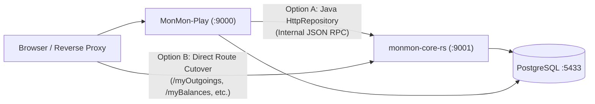

# MonMon Rust Rewrite Plan ("Ship of Theseus" on Greenstreet)

> **Thesis**: DHH's argument that modern hardware (even a £60 Raspberry Pi 5 with 4GB RAM and a SATA SSD) can comfortably run an entire suite of production web apps—**if** we stop burning gigabytes of RAM and CPU cycles on heavy JVM runtimes, reflection-heavy ORMs, and bloated enterprise auth servers.
>
> **Goal**: Incrementally replace the 3-JVM stack (`MonMon-Play`, `LegMon`, `Keycloak 12.0.2`) on Greenstreet with single-binary, zero-GC Rust services (`axum` + `sqlx` + `askama`) without downtime, schema breakage, or big-bang rewrite risk.

# 2026-11-08 HOW IT WENT

In short, Gemini 3.8 Flash started with this plan, then:

- wrote migration / playwright tests for most GETs and some POSTs to compare the Java and Rust versions
- chose to use its own hand rolled auth (monmon-auth) which I then steered back towards RAuthy
- hardcoded a demo user into the rust system
- Did not initially get the notion of a shared header or nav system at all
- The biggest glaring problem was auth: even though I'd heavily hinted to use RAuthy,
Gem went ahead with hardcoding usernames and passwords everywhere, messing up passkeys, and in the finish deployed and ran Rauthy but left it unattached to the app
- and for RAuthy, gem has no qualms about commited secrets into the repo. This repo is public and so generally, this is bad

Generally, it got about 30% of the way there, then I went through and picked the UI apart
and asked Gem to fix them all piecemeal.

Generally, a very impressive to the DHH 'pencils down' experiment on a Java -> Rust rewrite.

And the point? An elaborate way to try and speed up MonMon on my RPi5 (greenstreet)

---

## Current vs. Target Footprint on Greenstreet (RPi 5, 4GB RAM)

| Component | Current Stack (3 JVMs) | Current RAM (Capped) | Target Stack (Rust + Lightweight OIDC) | Target RAM |
| :--- | :--- | :--- | :--- | :--- |
| **Auth / OIDC** | Keycloak 12.0.2 (WildFly / Java 11) | ~550–700 MB RSS | **Pocket ID** / **Kanidm** / **Zitadel** / **Rauthy** | ~25–60 MB RSS |
| **LegMon (:9005)** | Scala 2.13 + JDK 21 (`legmon.jar`) | ~180–240 MB RSS | `legmon-rs` (`axum` + `reqwest` + `serde`) | ~12–20 MB RSS |
| **MonMon (:9000)** | Play 2.8 + Guice + Hibernate + JDK 21 | ~550–750 MB RSS | `monmon-rs` (`axum` + `sqlx` + `askama`) | ~25–45 MB RSS |
| **Database (:5433)** | PostgreSQL 15 (Docker) | ~150 MB RSS | PostgreSQL 15 (Unchanged, more RAM for shared buffers!) | ~250 MB RSS (faster caching) |
| **Total App Footprint** | **~1.4–1.8 GB RAM** | Cold starts: 15–40s | **< 120 MB RAM** | Cold starts: **< 50ms** |

---

## Core Architectural Decisions for the Rust Stack

1. **Web Framework**: **`axum`** (`tokio` async runtime, `tower-http` middleware).
2. **Database Layer**: **`sqlx`** (compile-time checked PostgreSQL queries, zero ORM overhead).
   - Aligns directly with `AGENTS.md`: *"Prefer PostgreSQL (`psql`) over in-memory Java: favor doing aggregations, rollups, and transformations directly in PostgreSQL."*
3. **Server-Side HTML Templates**: **`askama`** (or **`maud`**) rendering the **exact same HTML structure, CSS (`public/stylesheets`), and plain `.js` (`public/javascripts`)** that MonMon uses today.
   - Zero frontend framework rewrite required; all existing mobile primitives (`spog-deck.js`, Stacked Action Cards) stay untouched.
4. **Deployment to Greenstreet**:
   - Cross-compile on the fast x86_64 workstation (`cargo zigbuild --release --target aarch64-unknown-linux-gnu`) producing a single ~15MB static binary.
   - `scp` binary to `greenstreet@greenstreet.local` and restart `systemd` or a `FROM scratch` / `debian:bookworm-slim` container in < 2 seconds.

---

## Stage 0: Solid Verification Framework (Black-Box Contract & UI Gate)

Before a single line of production Java or Scala is replaced, the verification suite must be **language-agnostic**. Currently, `RealDatabaseSystemTest.java` instantiates Play's `Server.forRouter` in-process and injects Java mocks/repositories. A Rust service cannot pass a Java in-process test.

### 0.1 Contract-Only REST & HTTP System Tests
Decouple system tests from Play's internals so they speak **pure HTTP + SQL** against `BASE_URL` (e.g. `http://127.0.0.1:9000` and `http://127.0.0.1:9005`):
- **JSON & Form Contract Suite**:
  - `GET /health` → `200 OK`
  - `GET /accounts`, `POST /account`, `POST /updateAccount`, `GET /binAccount/:id`
  - `GET /incomings`, `POST /incoming`, `POST /updateIncoming`, `GET /binIncoming/:id`
  - `GET /outgoings`, `POST /outgoing`, `POST /updateOutgoing`, `POST /pauseOutgoing/:id`, `POST /unpauseOutgoing/:id`, `GET /binOutgoing/:id`
  - `GET /balances`, `POST /balance`, `POST /balance/:id/delete`, `GET /api/balances/erratic`
  - `POST /api/monzo/webhook`, `POST /api/statement/webhook`, `POST /api/bank/statement/:id/confirm`, `GET /api/bank/statement/:id/preview`
  - `GET /api/nommon/plan`, `POST /api/nommon/lock`, `POST /api/nommon/unlock`
  - `GET /api/dig/data`, `GET /api/search?q=...`, `GET /api/user/accessStatus`
- **Database Invariant Assertions**:
  - Verify exact PostgreSQL row state (`account`, `incoming`, `outgoing`, `balance`, `bank_transaction`, `pending_statement`, `savings_plan`, `net_worth_asset`) before and after HTTP calls.
- **Dual-Target Execution**:
  - The exact same test suite runs against `MonMon-Play` today and against `monmon-rs` (or the hybrid strangler proxy) tomorrow.

### 0.2 End-to-End UI Suite Driven by `playwright-cli`
For all server-rendered HTML views (`Twirl` today → `Askama` tomorrow) and plain `.js` interactions:
- Drive headless browser flows via `playwright-cli` against a seeded PostgreSQL database:
  1. **Outgoings (`/myOutgoings`)**: Filter tabs (Monthly, Yearly, Paused, All), Add/Amend modal, Pause modal (including names with apostrophes/brackets!), Unpause, Delete.
  2. **Accounts (`/myAccounts`) & Incomings (`/myIncomings`)**: Desktop table & mobile Stacked Action Card layout, CRUD modals.
  3. **Balances (`/myBalances`)**: Recording new balances, Erratic Balances modal (`/api/balances/erratic`), deletion.
  4. **SPOG (`/spog`)**: Desktop dashboard & mobile `spog-deck` swipeable cards, `/historicSpent`, `/spendingPace`.
  5. **Savings Plan (`/savingsPlan`) & Net Worth (`/netWorth`)**: Queue reordering, lock/unlock, balance evenly, asset CRUD.
  6. **Bank Sync (`/bank`) & Dig (`/dig`)**: Statement upload preview/confirm modal, ABL/TBL toggle, heatmap data load.

### Stage 0 Exit Criteria
- `./run_contract_tests.sh` and `./run_playwright_tests.sh` pass 100% against the running Dockerized stack without importing a single Play/Java class.

---

## Stage 1: Auth Rethink (Retiring Keycloak 12.0.2 & Java `pac4j`)

Keycloak 12.0.2 (from 2021) runs on WildFly/JBoss and consumes ~600MB RAM just to authenticate a handful of users on `identity.dryark.uk`. Furthermore, Play's `pac4j` session serialization locks session cookies to Java object serialization.

### 1.1 Evaluate Modern Open-Source OIDC Providers for ARM64
| Candidate | Language | RAM Usage | Highlights |
| :--- | :--- | :--- | :--- |
| **Rauthy** | **Rust** | **~25 MB** | Single binary, built in Rust, full OIDC provider with passkeys/WebAuthn + password + MFA, embedded SQLite/Hiqlite or Postgres, native ARM64 Docker image. |
| **Pocket ID** | Go | ~30 MB | Ultra-minimal OIDC provider focused purely on Passkeys (WebAuthn). Zero bloat. |
| **Kanidm** | **Rust** | ~50 MB | Rust-built identity management & OIDC server with strong security defaults and ARM64 support. |
| **Authelia** / **Authentik** | Go / Python | ~50 MB (Authelia) | Authelia is a tiny single Go binary (~50MB RAM) that acts as both an OIDC provider and forward-auth portal. |
| **Keycloak 26 (Quarkus)** | Java 21 | ~350 MB | Faster than WildFly Keycloak 12, but still 10x heavier than Rauthy/Pocket ID/Authelia. |

**Recommendation**: **Rauthy** (all-Rust, ~25MB RAM, drop-in OIDC replacement for `identity.dryark.uk`) or **Pocket ID** (if going pure Passkey).

### 1.2 Decouple Session Cookies from Java `pac4j`
To allow Java (`MonMon-Play`) and Rust (`monmon-rs`) to run side-by-side during the Ship of Theseus migration:
- Introduce a **shared, language-neutral session token** (either a signed JWT cookie `monmon_session` using HMAC-SHA256 / Ed25519 with a shared secret in `.env`, or a `user_sessions` table in PostgreSQL).
- Both Java and Rust can verify the cookie and extract `user_id` (`sub`), `username`, and `user_access_status` (`APPROVED`) without `pac4j` Java deserialization.

### Stage 1 Exit Criteria
- `identity.dryark.uk` runs on the new lightweight OIDC provider on Greenstreet using < 50MB RAM.
- Session cookie format is readable by both MonMon-Play and Rust middleware.

---

## Stage 2: LegMon Rust Rewrite (`legmon-rs`)

`legmon` is the ideal first Rust target: it is already a standalone microservice on port `:9005`, has no database of its own, and consists of only 7 Scala files (~1,600 LOC).

### 2.1 Scope of `legmon` (`legmon/src/main/scala/legmon/`)
1. `Main.scala` → HTTP server on `:9005` exposing:
   - `GET /health`
   - `GET /status`
   - `GET /logs`
   - `POST /ocr/statement` (accepts PDF/image statement upload, parses transactions, callbacks or returns JSON)
   - `POST /webhook/monzo` (forwards/normalizes Monzo webhooks to `MONMON_URL`)
2. `DeterministicStatementParser.scala` → Regex & line-based parser for UK bank statements (NatWest, Monzo, Amex, HSBC, Santander, etc.).
   - Translates 1:1 to Rust's `regex` crate (which is linear-time, SIMD-accelerated on ARM64 NEON, and significantly faster than JVM `java.util.regex`).
3. `OcrService.scala` → Invokes `pdftotext` (`poppler-utils`) and `tesseract` CLI via `tokio::process::Command`.
4. `MistralOcrService.scala` & `MistralExtractionService.scala` → Async HTTP client calls (`reqwest`) to Mistral API.
5. `MonzoWebhookSender.scala` → Posts parsed payloads to `http://127.0.0.1:9000/api/statement/webhook` or `/api/monzo/webhook`.
6. `LogBuffer.scala` → Thread-safe ring buffer (`Arc<Mutex<VecDeque<LogEntry>>>`) for `/logs`.

### 2.2 Rollout & Fallback Strategy
- Build `legmon-rs` in `rust-rewrite/legmon-rs/`.
- Run Stage 0 statement-parsing unit and contract tests against `legmon-rs`.
- Deploy `legmon-rs` container on Greenstreet `:9005`.
- **Instant Rollback**: If anything misbehaves, `docker run` the previous `legmon:latest` JVM image in 3 seconds.

### Stage 2 Exit Criteria
- `legmon-rs` serves `:9005` on Greenstreet using **< 20MB RAM** (down from ~200MB) and parses PDF statements 3–5x faster.

---

## Stage 3: Rust Rewrite of Core Primitives (Accounts, Incomings, Outgoings, Balances)

These four domains form the foundational ledger of MonMon. Every higher-level feature (SPOG, Savings Plan, Net Worth) reads from these four PostgreSQL tables:
- `account` (`models.Account`)
- `incoming` (`models.Incoming` + UK Bank Holiday / effective pay-day adjustment logic)
- `outgoing` (`models.Outgoing` + monthly/yearly/multi-year interval, pause/unpause, UK Bank Holiday clamping)
- `balance` (`models.Balance` + erratic balance jump detection)

### 3.1 Two Strangler-Fig Integration Patterns (Can Be Used Together)



1. **Pattern A — Side-by-Side Rust Core Service + Java `HttpRepository` Bridge**:
   - Notice that MonMon-Play already uses interfaces for data access:
     - `AccountRepository` (currently bound to `JPAAccountRepository` in Guice)
     - `IncomingRepository` (bound to `JPAIncomingRepository`)
     - `OutgoingRepository` (bound to `JPAOutgoingRepository`)
     - `BalanceRepository` (bound to `JPABalanceRepository`)
   - We run `monmon-core-rs` on `127.0.0.1:9001` talking directly to PostgreSQL via `sqlx`.
   - In Java, we implement `RustAccountRepository`, `RustIncomingRepository`, `RustOutgoingRepository`, and `RustBalanceRepository` that call `monmon-core-rs` over loopback HTTP (`127.0.0.1:9001/internal/...`), toggled via a config flag (`monmon.repo.backend = "rust" | "jpa"`).
   - This lets us validate all Rust SQL queries, date/holiday clamping logic (`BankHolidayHelper`), and totals calculations in production while Play still renders `spog.scala.html`!
2. **Pattern B — Full Route & View Cutover for Core Pages**:
   - Once the Rust domain logic and `sqlx` queries are proven via Pattern A, `monmon-core-rs` also serves the HTML and form POST routes directly (using `Askama` templates that match `accounts.scala.html`, `incomings.scala.html`, `outgoings.scala.html`, and `balances.scala.html` byte-for-byte):
     - `/myAccounts`, `/account`, `/accounts`, `/editAccount/:id`, `/updateAccount`, `/binAccount/:id`
     - `/myIncomings`, `/incoming`, `/incomings`, `/editIncoming/:id`, `/updateIncoming`, `/binIncoming/:id`
     - `/myOutgoings`, `/outgoing`, `/outgoings`, `/editOutgoing/:id`, `/updateOutgoing`, `/pauseOutgoing/:id`, `/unpauseOutgoing/:id`, `/binOutgoing/:id`, `/api/ed-says-outgoings`
     - `/myBalances`, `/balance`, `/balances`, `/balance/:id/delete`, `/api/balances/erratic`

### Stage 3 Exit Criteria
- All CRUD operations, erratic balance detection, and UK bank-holiday date adjustments for Accounts, Incomings, Outgoings, and Balances execute in Rust (`monmon-core-rs`), verified by Stage 0 contract + Playwright tests.

---

## Stage 4+: SPOG & Continuous "Ship of Theseus" Migration

With `monmon-core-rs` owning the core primitives and acting as the reverse-proxy entrypoint on `:9000` (forwarding any not-yet-migrated routes to `MonMon-Play` on `:9002`), we migrate the remaining modules one by one.

### Wave 4.1: SPOG ("Single Pane of Glass") & Spending Pace
- **Routes**: `GET /spog`, `GET /spog/seed`, `GET /historicSpent`, `GET /spendingPace`, `GET /api/ed-says`
- **Why this will fly on the Pi 5**:
  - Today, `SpogController.index` pulls accounts, balances, incomings, outgoings, plans, pots, and transactions into Java memory and crunches time-series projections on every page load.
  - In Rust (`monmon-rs`), we combine `tokio::try_join!` concurrent `sqlx` queries with PostgreSQL window functions and render `spog.html` in **< 5ms**.

### Wave 4.2: Sharing Plans & Monthly Pots
- **Routes**:
  - `/myPlans`, `/plan`, `/binPlan/:id`, `/plans`, `/plans/updateSavingsPayoffPercentage`
  - `/myMonthlyPot`, `/pot`, `/pot/applyGruelling`, `/binPot/:id`

### Wave 4.3: Savings Plan & Net Worth Tracker
- **Routes**:
  - `/savingsPlan*`, `/editSavingsPlanItem/:id`, `/binSavingsPlan*` (queue ordering, lock/unlock, balanceEvenly, trimDeficit, saveAllocations)
  - `/netWorth`, `/netWorth/addAsset`, `/netWorth/updateAsset/:id`, `/netWorth/binAsset/:id`, `/api/ed-says-networth`

### Wave 4.4: Bank Sync (Monzo OAuth + Webhooks + Statement Ingestion) & Monzo Dig
- **Routes**:
  - `/bank*`, `/api/monzo/webhook`, `/api/statement/webhook`, `/api/bank/statement/:id/*`, `/api/legmon/*`
  - `/dig`, `/monzo-dig`, `/api/dig/data`, `/api/monzo-dig/data`
- Move the AES-GCM token encryption for `monzo_connection` (`ring` / `aes-gcm` crate in Rust, compatible with the existing encryption format) and the geospatial/category aggregation queries for `/dig` into Rust.

### Wave 4.5: Secondary Features & Final JVM Decommission
- **Routes**:
  - `/nommon`, `/api/nommon/*` (Smart Grocery & Meal Planner)
  - `/api/search` (App-wide unified search — already backed by PostgreSQL views/queries in `AppSearchMigration`)
  - `/settings*`, `/waitinglist`, `/api/user/accessStatus`, `/`, `/about`, `/health`
- **Decommission Play**:
  - Once the proxy table in `monmon-rs` has zero remaining fallback routes to `:9002`, stop and remove the `monmon` JVM container from Greenstreet.
  - Embed database migrations (`sqlx migrate!`) directly into `monmon-rs` startup.

---

## Directory Layout Inside `rust-rewrite/`

```text
rust-rewrite/
├── README.md                  # This master plan
├── tests-contract/            # Stage 0: Language-agnostic HTTP + SQL contract tests
├── tests-e2e/                 # Stage 0: playwright-cli test specs & runner
├── auth-migration/            # Stage 1: Lightweight OIDC config & shared session spec
├── legmon-rs/                 # Stage 2: Standalone Rust replacement for LegMon (:9005)
└── monmon-rs/                 # Stage 3 & 4+: Incremental Rust replacement for MonMon (:9000)
```
